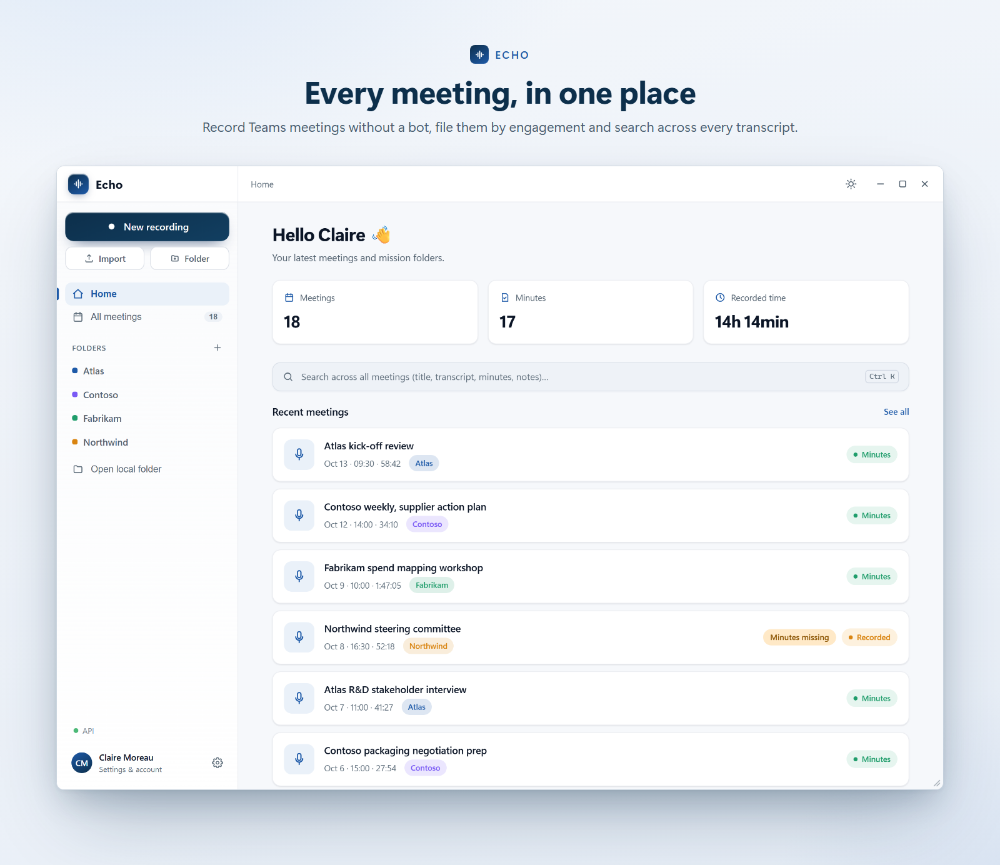
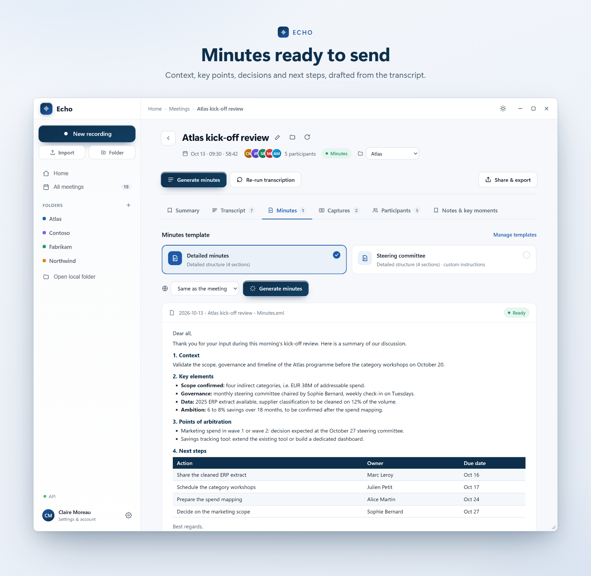
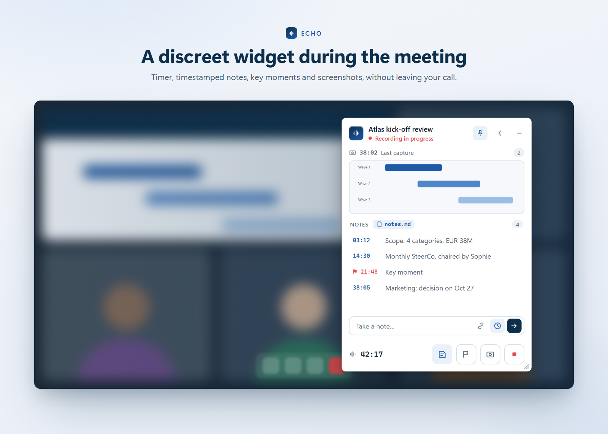

<p align="center"></p>
<h1 align="center">Echo</h1>
<p align="center">Grabe sus reuniones de Teams y obtenga la transcripción y un acta lista para enviar. Sin bot en la reunión.</p>
<p align="center">
  
  
  
  
</p>
<p align="center"><a href="README.md">English</a> · <a href="README.fr.md">Français</a> · <b>Español</b></p>

> **Por ahora, solo Windows y Microsoft Teams.** Las reuniones presenciales grabadas en un PC con
> Windows también funcionan. macOS, Google Meet y Zoom están en la [hoja de ruta](#hoja-de-ruta).

Echo graba sus reuniones de Teams (o presenciales) en Windows, transcribe quién dijo qué y redacta
un acta lista para enviar. Ningún bot se une a la reunión: Echo capta el audio del PC y lee los
nombres de los participantes directamente en la ventana de Teams.

**Ayuda:** la [guía de uso](help/README.es.md) explica la configuración, la grabación, las claves API y la solución de problemas.



## Qué hace Echo

- **Grabación** de dos pistas (su micrófono y el audio de los demás participantes), iniciada a
  mano, con un atajo de teclado o al detectar una reunión de Teams. Un pequeño widget permanece en
  pantalla durante la reunión: notas con marca de tiempo, capturas de pantalla, marcadores.
- **Transcripción** con Mistral (Voxtral), Google Gemini o Cloudflare Workers AI (Whisper), con los
  oradores identificados gracias a los nombres leídos en Teams.
- **Acta** (.eml lista para abrir en Outlook, .docx, .md) y un resumen breve, con plantillas de
  acta personalizables y un vocabulario profesional, redactados por Mistral, Gemini, Cloudflare o
  cualquier modelo de OpenRouter. Las reuniones largas se resumen por partes automáticamente.
- **Importación** de un archivo de audio o de una transcripción de Teams (.docx / .vtt).
- **Búsqueda** en todas las reuniones, misiones, gestión del almacenamiento, actualizaciones
  automáticas.





## Privacidad

Las grabaciones permanecen en su PC. Solo el audio que se va a transcribir y el texto que se va a
resumir se envían al proveedor de IA que usted elija, con **su propia clave API**, guardada cifrada
(DPAPI de Windows). Avise a los participantes de que la reunión se está grabando.

## Instalación

**[Descargue Echo-Setup.exe](https://github.com/romainio/echo-recorder/releases/latest/download/Echo-Setup.exe)**
y haga doble clic en él. Echo se instala en su perfil de usuario (`%LOCALAPPDATA%\Programs\Echo`),
sin derechos de administrador, y se actualiza solo. En el primer inicio, pegue su clave API en
Ajustes > Proveedores: los modelos marcados como **Free** funcionan con una clave gratuita.

El instalador aún no está firmado: si Windows muestra «Windows protegió su PC», pulse «Más
información» y luego «Ejecutar de todas formas». Todas las versiones están en
[Releases](../../releases).

Requisitos: Windows 10 u 11 con WebView2, Microsoft Teams (nueva versión). La interfaz está
disponible en francés e inglés.

## Hoja de ruta

- Versión para **macOS**.
- Compatibilidad con **Google Meet** y **Zoom** (detección de la reunión y nombres de los
  participantes).
- Botón «Informar de un problema» en la aplicación.
- Instalador firmado (sin aviso de Windows en la primera instalación).

## Compilar

```powershell
dotnet build Echo.sln -c Release
dotnet test tests/Echo.Tests/Echo.Tests.csproj
```

.NET 8 SDK, WPF + WebView2 (interfaz en `ui/`), NAudio (captura WASAPI), FlaUI (lectura de Teams).
Ver `docs/ARCHITECTURE.md`. `ffmpeg.exe` debe estar en `bin/` junto al exe
(`tools/get-ffmpeg.ps1` lo descarga).

## Comentarios

Los errores y las ideas son bienvenidos en [Issues](../../issues).

## Licencia

[MIT](LICENSE), Copyright (c) 2026 Echo contributors. Componentes de terceros (incluido FFmpeg,
distribuido como programa de audio independiente bajo LGPL, fuentes en la release ffmpeg-audio): `THIRD-PARTY-NOTICES.md`.

Microsoft Teams, Windows, Google Meet, Zoom y macOS son marcas de sus respectivos propietarios.
Echo es un proyecto independiente, sin afiliación ni respaldo de dichas empresas.
