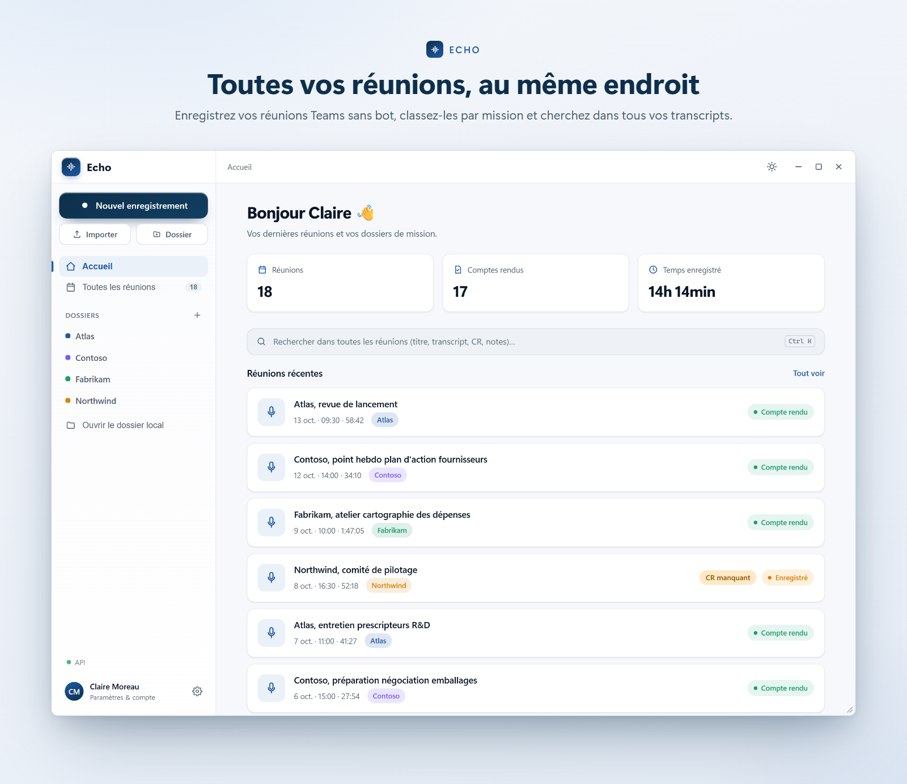
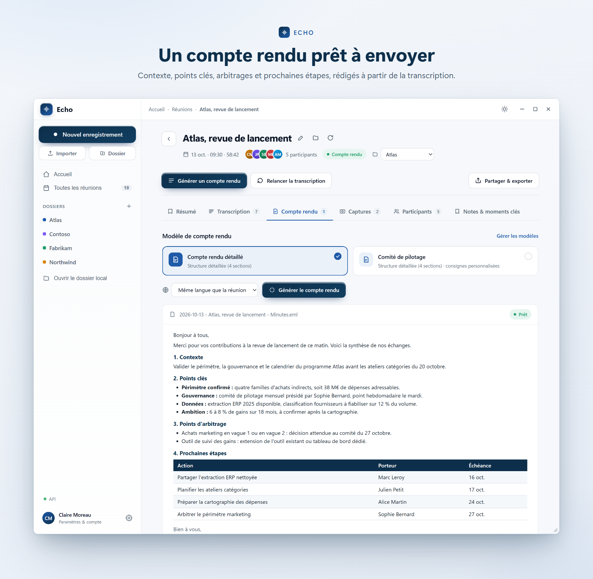
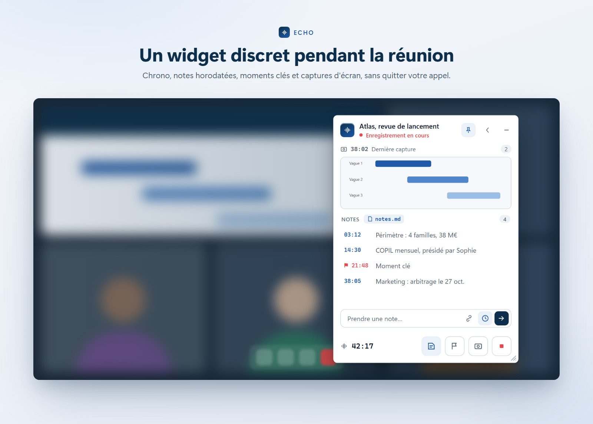

<p align="center"><a href="README.md">English</a> · <b>Français</b> · <a href="README.es.md">Español</a></p>

# Echo

Echo enregistre vos réunions Teams (ou en présentiel) sur Windows, transcrit qui a dit quoi
et rédige un compte rendu prêt à envoyer. Aucun robot ne rejoint la réunion : Echo capte le son
du PC et lit les noms des intervenants directement dans la fenêtre Teams.



## Ce que fait Echo

- **Enregistrement** de deux pistes (votre micro et le son des participants), lancé à la main,
  par raccourci clavier ou à la détection d'une réunion Teams. Un petit widget reste à l'écran
  pendant la réunion : notes horodatées, captures d'écran, marqueurs.
- **Transcription** avec Mistral (Voxtral) ou Cloudflare Workers AI (Whisper), locuteurs nommés
  grâce aux noms lus dans Teams.
- **Compte rendu** (.eml prêt à ouvrir dans Outlook, .docx, .md) et résumé court, avec des modèles
  de CR personnalisables et un vocabulaire métier. Les longues réunions sont résumées par parties
  automatiquement.
- **Import** d'un fichier audio ou d'une transcription Teams (.docx / .vtt).
- **Recherche** dans toutes les réunions, missions, gestion du stockage, mises à jour automatiques.





## Confidentialité

Les enregistrements restent sur votre PC. Seul l'audio à transcrire et le texte à résumer sont
envoyés au fournisseur d'IA que vous choisissez, avec **votre propre clé API**, stockée chiffrée
(DPAPI Windows). Prévenez les participants que la réunion est enregistrée.

## Installation

La publication des versions dans [Releases](../../releases), avec un installeur téléchargeable,
est en cours de mise en place. Echo s'installe dans votre profil (`%LOCALAPPDATA%\Programs\Echo`),
sans droits administrateur, et se met à jour tout seul. Au premier lancement, collez votre clé API
dans Paramètres > Fournisseurs : les modèles marqués **Free** fonctionnent avec une clé gratuite.

Prérequis : Windows 10 ou 11 avec WebView2, Microsoft Teams (nouvelle version). L'interface est
disponible en français et en anglais.

## Compiler

```powershell
dotnet build Echo.sln -c Release
dotnet test tests/Echo.Tests/Echo.Tests.csproj
```

.NET 8 SDK, WPF + WebView2 (interface dans `ui/`), NAudio (capture WASAPI), FlaUI (lecture de
Teams). Voir `docs/ARCHITECTURE.md`. `ffmpeg.exe` est attendu dans `bin/` à côté de l'exe
(`tools/get-ffmpeg.ps1` le télécharge).

## Retours

Bugs et idées sont les bienvenus dans [Issues](../../issues).

## Licence

Copyright (C) 2026 Echo contributors.

Echo est un logiciel libre sous licence GNU GPL v3 ou ultérieure (SPDX : `GPL-3.0-or-later`),
voir `LICENSE`. Composants tiers : `THIRD-PARTY-NOTICES.md`.
